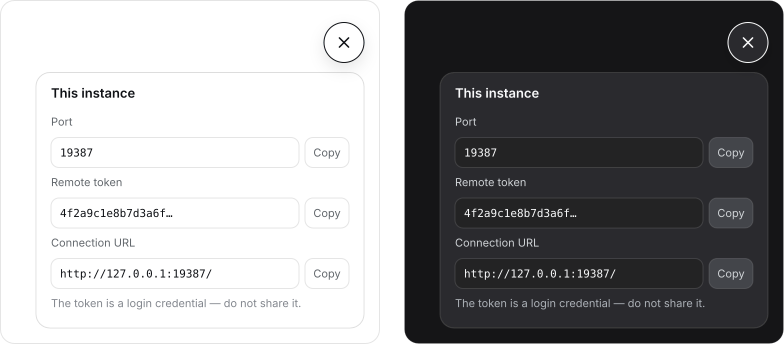

# dsh-port-token

A key badge for the bottom-right corner of the **DeepSeek Harness** Web GUI. Click it and you get the
port this harness is listening on and the remote-access token a client needs to connect. Click again
and it is gone.




[中文](README.zh-CN.md)

## Install

Requires DeepSeek Harness Desktop (bundled `dsh` 0.2.1-rc.3 or newer).

The `desktop` profile belongs to the Electron app, so the npm `dsh` CLI refuses to touch it. Use the
command the app ships instead:

```powershell
$dsh = "$env:LOCALAPPDATA\Programs\DeepSeek Harness\resources\runtime\cli\bin\dsh.cmd"
& $dsh plugin --profile desktop add github:CAOGGL/dsh-port-token
```

Restart DeepSeek Harness — the badge is in the corner.

Working on the plugin itself? Install your checkout instead; edits show up after a page reload:

```powershell
& $dsh plugin --profile desktop add link:C:\path\to\dsh-port-token-plugin
```

Any profile other than `desktop` works with a normal `dsh` too, e.g.
`dsh plugin --profile web add github:CAOGGL/dsh-port-token`.

## Using it

| Do this | What happens |
| --- | --- |
| click the key | the panel opens and the key turns into a cross |
| click it again, press `Esc`, or click beside the panel | it closes |
| click `Copy` on a row | that one value is copied; the label reads `Copied` for a moment |

Every open asks the host again, so a restarted harness never shows a stale port.

## What you get

- **Port** — the one actually bound, including when the harness was started with `--port 0`.
- **Token** — the same remote-access token `dsh web` prints at startup. Treat it like a password.
- **URL** — `http://127.0.0.1:<port>/`, ready to paste.
- One copy button per row, light and dark themes, Chinese and English UI.

## How it works

`dsh web` trades the token for an HttpOnly cookie and redirects to a clean URL, so the page can never
read its own token — and with `--port 0` it does not even know its own port. Both facts exist only in
the host process, which is why the plugin has two halves:

- `lib/index.js` — one route, `GET /dsh-port-token/info`. It sits behind `ctx.connection.admit(req)`,
  the same Host/Origin and session fence that guards `/api`: no cookie gets `401`, a foreign origin
  gets `403`, other verbs get `405`.
- `lib/client.js` — the badge itself, registered into the shell overlay slot. No build step, no
  bundler: React comes from the page’s own module table.

There is nothing to configure and nothing else in the package.

## Uninstall

```powershell
& $dsh plugin --profile desktop remove dsh-port-token
```

## Development

```powershell
npm test                        # both suites, no node_modules needed
node tools/build-preview.mjs    # redraw docs/preview-*.svg
```

## License

MIT © 2026 CAOGGL
