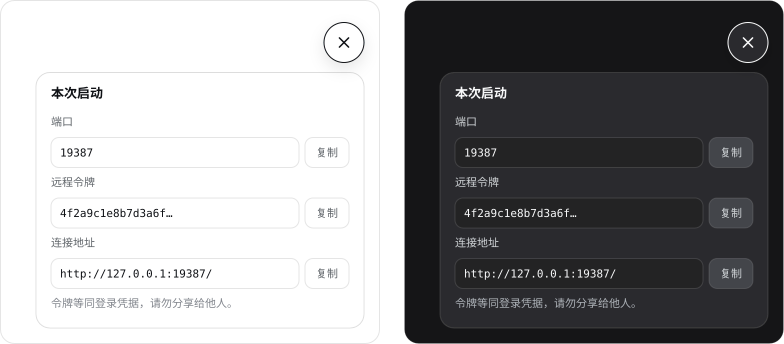

# dsh-port-token


A DeepSeek Harness (dsh) Web GUI plugin. One key badge sits in the bottom-right corner of the page:
click it and a panel opens with **the port this instance is listening on** and **the remote-access
token** a client has to present — the very `?token=…` from the `dsh web: http://127.0.0.1:<port>/?token=…`
line printed at startup. Click the badge again and the panel collapses.

**English** · [中文](#中文说明)

## What it shows


*Light and dark, at 1×. The badge lives in the shell overlay's bottom-right corner; while the panel is
open the key has rotated into a cross. Values are illustrative — the token is truncated.*

| Action | Result |
| --- | --- |
| click the badge | panel opens, the key rotates into a cross |
| click it again | panel closes, the cross becomes the key again |
| `Esc` | closes |
| click anywhere beside the panel | closes |
| click a copy button | copies that one value; the button reads “Copied” for 1.4 s |

The panel asks the host process for port and token **on every open**, so a restarted harness never
shows a stale port. Copying prefers `navigator.clipboard` and falls back to `document.execCommand`
where the clipboard API is unavailable.

## Why it takes two halves

`dsh web` prints `http://127.0.0.1:<port>/?token=…` once at startup. The page trades that token for
an HttpOnly cookie and is then redirected to a clean URL — **the token never reaches page script**.
The port is no better: with `--port 0` only the main process knows what the OS handed out. So the
numbers have to come from the host side.

| Half | File | Job |
| --- | --- | --- |
| Host | `lib/index.js` | reads `ctx.webServer.port` and `ctx.connection.authenticatedUrl()`, serves them as JSON on `GET /dsh-port-token/info` |
| Browser | `lib/client.js` | registers the badge into the shell's `shell.overlay` slot, fetches that route on open, renders the panel, owns the key ⇄ cross morph and close-on-outside-click |

## Security

- `/dsh-port-token/info` is admitted by `ctx.connection.admit(req)` — the same Host/Origin fence and
  browser-session check that guards `/api`. No session cookie returns `401`; a cross-site origin
  returns `403`. **Anyone who can read this JSON could already drive this harness.**
- Only `GET` is accepted; anything else returns `405` with `allow: GET`.
- Responses carry `cache-control: no-store`.
- The panel states it in the UI: a token is a login credential, do not share it.

The panel names its own failure states instead of showing a blank box: `401` → the browser session
expired, `403` → the request origin is not trusted, a missing route → the host half is not loaded,
anything else → read failed, with a retry button.

## Install

### Desktop app

`desktop` is the Electron app's own profile, and only the command the Desktop installation ships may
manage it. The npm CLI refuses it:

```text
$ dsh plugin --profile desktop add github:CAOGGL/dsh-port-token
error: profile "desktop" is managed exclusively by the Electron application
```

The bundled command lives inside the installation:

```powershell
$dsh = "$env:LOCALAPPDATA\Programs\DeepSeek Harness\resources\runtime\cli\bin\dsh.cmd"
& $dsh plugin --profile desktop add github:CAOGGL/dsh-port-token
```

That is the whole install. `pnpm` adds the dependency, and the CLI appends `dsh-port-token` to
`dsh.profile.bundles` in `%DSH_HOME%\profiles\desktop\package.json` because the package declares
`"dsh": { "bundle": { "patch": "./cordis.patch.yml" } }`. The profile's own `cordis.patch.yml` is
left alone — the app rewrites that file with its own settings and would drop a hand-added row.

**Restart DeepSeek Harness afterwards**: bundles are composed at boot, so the badge appears on the
next start.

### Local development

Point the same command at your checkout instead of GitHub. `link:` keeps the profile reading the
working copy, so edits show up without reinstalling:

```powershell
& $dsh plugin --profile desktop add link:C:\path\to\dsh-port-token-plugin
```

### Other profiles

Every name except `desktop` also works with the npm CLI, as long as `pnpm` is on `PATH`:

```powershell
dsh plugin --profile web add github:CAOGGL/dsh-port-token
```

## Uninstall

```powershell
$dsh = "$env:LOCALAPPDATA\Programs\DeepSeek Harness\resources\runtime\cli\bin\dsh.cmd"
& $dsh plugin --profile desktop remove dsh-port-token
```

Restart afterwards. The dependency and its bundle entry are gone; nothing outside the profile
directory was touched.

## Compatibility


Verified against the runtime bundled with **DeepSeek Harness Desktop 0.2.1** (`dsh 0.2.1-rc.3`):

- Host: `ctx.webServer.register({ kind: 'exact', path, handler })`, `ctx.webServer.port`,
  `ctx.connection.admit()`, `ctx.connection.authenticatedUrl()`, `ctx.effect()`.
- Browser: `ctx.slots.inject()` / `ctx.slots.register()` (`shell.overlay` is a list slot rendered by
  `dsh-client-ui-layout` as a `position: absolute; inset: 0` layer), `ctx.locale.register()` /
  `ctx.locale.bind()`.
- React comes from the platform module table, so there is **no bundler, no build step and no
  `dsh.client.external`** to declare. The browser half is plain ESM-ish JS behind
  `window.__ModuleLoader__.load`.
- Styling uses the host's design tokens (`--dsw-alias-bg-layer-1`, `--dsw-alias-border-l2`,
  `--dsw-alias-label-secondary`, `--dsw-alias-brand-primary`, …), so light and dark themes both work.
- UI text is bilingual (`zh` / `en`) and follows the page language.

## Repository layout

| Path | Role |
| --- | --- |
| `lib/index.js` | host half — the `/dsh-port-token/info` route |
| `lib/client.js` | browser half — badge, panel, styles |
| `cordis.patch.yml` | bundle patch that mounts both halves in one row |
| `tools/verify-host.mjs`, `tools/verify-browser.mjs` | contract and render tests |
| `icon.svg` | the badge icon |
| `docs/preview-en.svg`, `docs/preview-zh.svg` | the figures above — generated, not drawn by hand |
| `tools/build-preview.mjs` | regenerates both from the panel's box math and the resolved design tokens |

## Verification

```powershell
npm test                        # both suites
node tools/verify-host.mjs      # 200 / 401 / 403 / 405 / 500, no-store, route released with the fiber
node tools/verify-browser.mjs   # registration, slot, four render states, copy feedback, Esc, retry
node tools/build-preview.mjs    # regenerate docs/preview-*.svg after changing the panel
```

Both suites run offline and need no `node_modules`: the browser suite drives the component through a
hand-written miniature hook runtime and fake DOM.

## License

MIT © 2026 CAOGGL

---

## 中文说明


DeepSeek Harness（dsh）Web 界面插件。页面**右下角**常驻一个钥匙徽标：点一下弹出面板，显示
**本实例的监听端口**和**远程连接所需的令牌**——也就是启动时打印的那行
`dsh web: http://127.0.0.1:<port>/?token=…` 里的 `?token=`。再点一下徽标，面板收起。

[English](#dsh-port-token) · **中文**

## 显示内容



*浅色与深色两套主题，1× 比例。徽标位于 shell overlay 的右下角，展开时钥匙已旋转成叉号。
图中取值仅作示意，令牌做过截断。*

| 操作 | 结果 |
| --- | --- |
| 点徽标 | 面板打开，钥匙旋转成叉号 |
| 再点一次 | 面板收起，叉号变回钥匙 |
| 按 `Esc` | 收起 |
| 点面板旁边的空白处 | 收起 |
| 点某行的复制按钮 | 只复制这一项；按钮显示「已复制」，1.4 秒后复原 |

面板**每次展开都会重新向主进程取值**，Harness 重启后不会残留旧端口。复制优先用
`navigator.clipboard`，剪贴板 API 不可用时回退到 `document.execCommand`。

## 为什么需要两个半边

`dsh web` 启动时打印一次 `http://127.0.0.1:<port>/?token=…`。页面用它换到 HttpOnly Cookie 后就被
重定向到干净 URL——**令牌再也到不了页面脚本**。端口同样如此：`--port 0` 时只有主进程知道操作系统
分配了哪个端口。所以这两个值只能由宿主侧提供。

| 半边 | 文件 | 职责 |
| --- | --- | --- |
| Host | `lib/index.js` | 读 `ctx.webServer.port` 与 `ctx.connection.authenticatedUrl()`，在 `GET /dsh-port-token/info` 上以 JSON 返回 |
| Browser | `lib/client.js` | 把徽标注册进 shell 的 `shell.overlay` 槽位，展开时请求上面的路由并渲染面板；钥匙⇄叉号的形变和「点空白关闭」都在这一半 |

## 安全边界

- `/dsh-port-token/info` 由 `ctx.connection.admit(req)` 把关——和 `/api` 完全相同的 Host/Origin
  信任栅栏 + 浏览器会话校验。没有会话 Cookie 返回 `401`，跨站来源返回 `403`。**能读到这份 JSON 的人，
  本来就有权操作这个 Harness。**
- 只接受 `GET`，其余方法返回 `405`，并带 `allow: GET`。
- 响应带 `cache-control: no-store`。
- 面板里直接写明：令牌等同登录凭据，请勿分享给他人。

面板会把自己的失败状态写清楚，而不是留一个空框：`401` → 浏览器会话已失效，`403` → 请求来源不受信任，
路由缺失 → 主进程半边未加载，其余 → 读取失败并给出重试按钮。

## 安装

### 桌面端

`desktop` 是 Electron 应用自己的 profile，只有桌面端自带的那条命令能管理它。npm 装的那个 `dsh` 会被
直接拒绝：

```text
$ dsh plugin --profile desktop add github:CAOGGL/dsh-port-token
error: profile "desktop" is managed exclusively by the Electron application
```

能管理它的命令在安装目录里：

```powershell
$dsh = "$env:LOCALAPPDATA\Programs\DeepSeek Harness\resources\runtime\cli\bin\dsh.cmd"
& $dsh plugin --profile desktop add github:CAOGGL/dsh-port-token
```

这就是全部。`pnpm` 装依赖，CLI 随后把 `dsh-port-token` 追加进
`%DSH_HOME%\profiles\desktop\package.json` 的 `dsh.profile.bundles`——因为包里声明了
`"dsh": { "bundle": { "patch": "./cordis.patch.yml" } }`。profile 自己的 `cordis.patch.yml` 完全
不动：那个文件归应用管，应用写自己的设置时会把手写的行丢掉。

**装完重启 DeepSeek Harness**：bundle 在启动时组合，徽标要下一次启动才出现。

### 本地开发

把同一个命令指向本地检出即可。`link:` 让 profile 直接读工作副本，改代码不用重装：

```powershell
& $dsh plugin --profile desktop add link:C:\path\to\dsh-port-token-plugin
```

### 其他 profile

除 `desktop` 以外的名字用 npm 版 CLI 就行，前提是 `pnpm` 在 `PATH` 上：

```powershell
dsh plugin --profile web add github:CAOGGL/dsh-port-token
```

## 卸载

```powershell
$dsh = "$env:LOCALAPPDATA\Programs\DeepSeek Harness\resources\runtime\cli\bin\dsh.cmd"
& $dsh plugin --profile desktop remove dsh-port-token
```

然后重启。依赖和它在 bundles 里的那一项都会消失，profile 目录之外没有改动。

## 兼容性


对着 **DeepSeek Harness 桌面端 0.2.1**（内置 `dsh 0.2.1-rc.3`）的真实运行时代码验证过：

- 宿主侧：`ctx.webServer.register({ kind: 'exact', path, handler })`、`ctx.webServer.port`、
  `ctx.connection.admit()`、`ctx.connection.authenticatedUrl()`、`ctx.effect()`。
- 浏览器侧：`ctx.slots.inject()` / `ctx.slots.register()`（`shell.overlay` 是
  `dsh-client-ui-layout` 声明的 list 槽位，渲染成 `position: absolute; inset: 0` 的覆盖层）、
  `ctx.locale.register()` / `ctx.locale.bind()`。
- React 取自平台模块表，所以**没有打包器、没有构建步骤，也不需要声明 `dsh.client.external`**。
  浏览器半边就是 `window.__ModuleLoader__.load` 里的普通 JS。
- 样式只用宿主的设计令牌（`--dsw-alias-bg-layer-1`、`--dsw-alias-border-l2`、
  `--dsw-alias-label-secondary`、`--dsw-alias-brand-primary` 等），明暗主题都跟着走。
- 文案中英双语（`zh` / `en`），跟随页面语言。

## 仓库结构

| 路径 | 作用 |
| --- | --- |
| `lib/index.js` | 宿主半边——`/dsh-port-token/info` 路由 |
| `lib/client.js` | 浏览器半边——徽标、面板、样式 |
| `cordis.patch.yml` | 用一行挂载两个半边的 bundle patch |
| `tools/verify-host.mjs`、`tools/verify-browser.mjs` | 契约测试与渲染测试 |
| `icon.svg` | 徽标图标 |
| `docs/preview-en.svg`、`docs/preview-zh.svg` | 上面那两张图——由脚本生成，不是手绘 |
| `tools/build-preview.mjs` | 按面板的盒模型与设计令牌的实际取值重新生成这两张图 |

## 校验

```powershell
npm test                        # 两套一起跑
node tools/verify-host.mjs      # 200 / 401 / 403 / 405 / 500、no-store、路由随 fiber 释放
node tools/verify-browser.mjs   # 注册、槽位、四种渲染状态、复制反馈、Esc、重试
node tools/build-preview.mjs    # 面板改动后重新生成 docs/preview-*.svg
```

两套都在离线状态下运行，也不需要 `node_modules`：浏览器那套用一个手写的迷你 hook 运行时加假 DOM
驱动组件。

## 许可

MIT © 2026 CAOGGL
